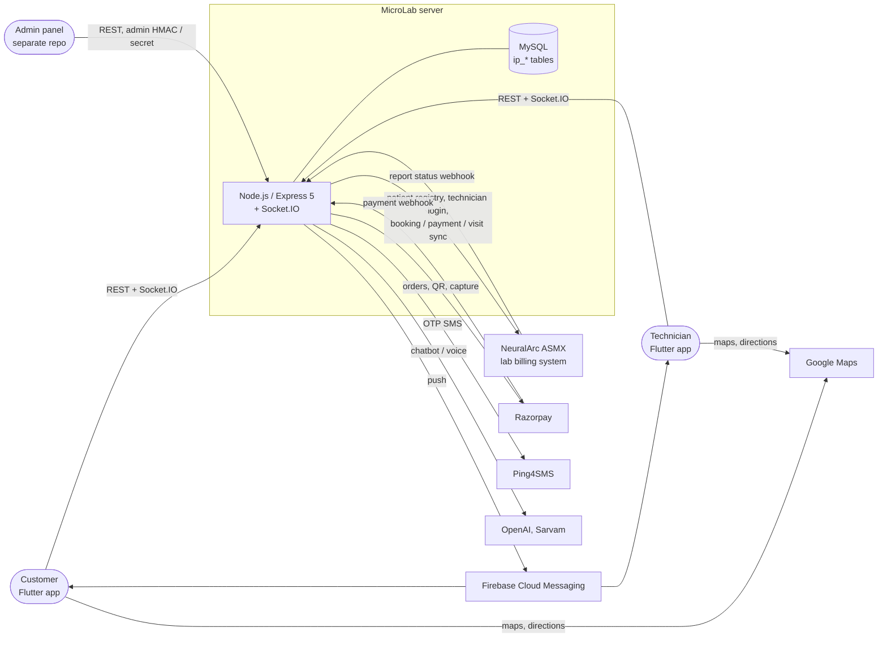
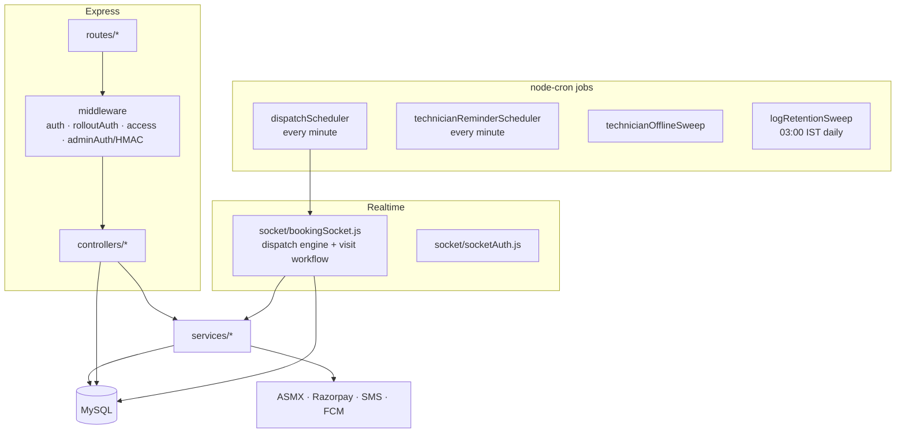
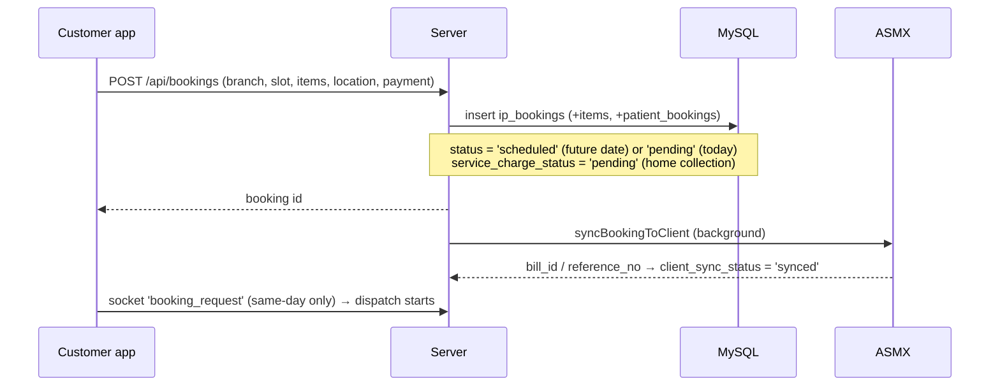
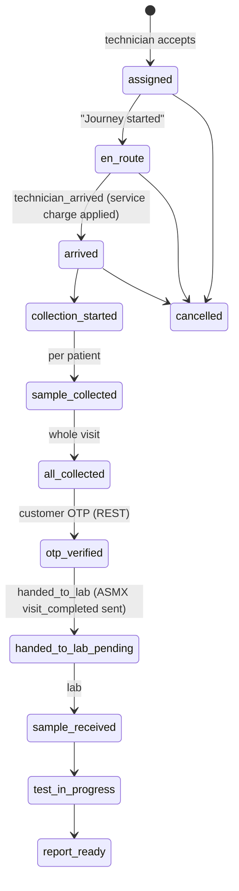

# MicroLab: Architecture Overview

This page explains how the system fits together and how the main business flows work. It is written for a developer joining the team. For table and column details, see the [data dictionary](../database/data-dictionary.md).

> Diagrams use [Mermaid](https://mermaid.js.org/), which GitHub and VS Code (with the Mermaid preview extension) render directly.

---

## 1. System context: who talks to whom

| External system | What MicroLab uses it for | Code |
|---|---|---|
| **ASMX** (the lab's billing / LIMS web service) | The source of truth for patients, technicians and bills. Customer login checks the patient registry. Technician login checks `TechnicianLoginCheck`. Every booking, cancellation, reschedule, payment, package change and completed visit is pushed to it. It calls back with report status. | `services/clientSync.js`, `controllers/authController.js`, `utils/secureId.js` |
| Razorpay | Online payment at checkout, QR / link payment collected by the technician, and the webhook confirming captures | `services/razorpay*.js`, `controllers/razorpayWebhookController.js` |
| Ping4SMS | Login OTP and the booking (sample handover) OTP | `utils/sms.js` |
| Firebase (FCM) | Booking requests to technicians whose app is in the background, reminders, and customer status pushes | `config/firebase.js`, `services/customerPush.js` |
| OpenAI / Sarvam | Support chatbot (RAG over the website and FAQ) and voice in and out | `routes/chat.js`, `rag/`, `routes/voice.js` |
| Google Maps | Map, live tracking, and the customer ↔ technician route polyline (Directions API, called from the app) | `client/lib/screens/customer/patient_ride_tracking_screen.dart` |

**ASMX authentication.** Every call to ASMX carries a `secure_id`, computed as HMAC-SHA256 of `mobile|user_type|timestamp` with a shared secret. The secret is held in memory (`services/secretCache.js`). If ASMX rejects the signature, the server reloads the secret from the database and retries once.

---

## 2. Inside the server

| Folder | Responsibility | Biggest files |
|---|---|---|
| `routes/` | URL → middleware → controller | `bookings.js`, `technicians.js` |
| `controllers/` | HTTP handlers | `bookingController.js` (~3.3k lines), `technicianController.js` (~2.2k), `authController.js`, `branchController.js` |
| `socket/` | The **dispatch engine** (finding a technician) and the **visit state machine** (en route → handover). It also keeps in-memory maps of online technicians and active searches. | `bookingSocket.js` (~3.7k lines) |
| `services/` | Business rules used by more than one caller | `clientSync.js` (ASMX), `serviceCharge.js`, `dispatchDistance.js`, `branchEligibility.js`, `technicianBranches.js`, `slotBranches.js`, `fareCalculator.js` |
| `scheduler/` | Background jobs (see §8) | |
| `config/` | DB pool (`db.js`, 10 connections), `settings.js` (`ip_settings` cache), Firebase | |
| `utils/dbLogger.js` | Writes copies of log lines into the `ip_*_logs` tables | |

**Important:** active booking searches live **in memory** in `bookingSocket.js`. A restart loses them. That is why startup calls `initDispatchState()` (rebuilds assignments from the DB) and, 60 seconds later, `recoverPendingDispatches()` (restarts searches once technicians have reconnected). Running two server instances would split this state. The design assumes **one process**.

---

## 3. Users, login and access

| Role | How they log in | Token |
|---|---|---|
| **Customer** | Mobile number → SMS OTP (`/api/auth/send-otp`, `/verify-otp`). On login, ASMX is asked whether the number is an existing patient. Their patient list (self and family) is copied into `ip_patients`. | JWT carrying `user_id`, role `customer` |
| **Technician** | Same OTP screen. The number is checked against ASMX `TechnicianLoginCheck`. The technician's ASMX branch codes are saved to `ip_technicians.branch_ids`. | JWT carrying `userId`, role `technician` |
| **Admin panel** | Not a user login. Server-to-server calls signed with a shared secret or HMAC (`adminAuth`, `adminSecret`, `adminBodyAuth`, `adminHmacAuth`). | none |

- **One active session per user.** The token must equal `ip_users.user_auth_token`. Logging in on another phone invalidates the old token immediately (`middleware/auth.js`).
- **Any 401 signs the app out.** The app treats every 401 as "session ended". So a business error, such as a wrong booking OTP, must return **400**, never 401.
- **`rolloutAuth`:** some older routes still accept calls without a token while older app versions are in use. The `ip_settings.api_auth_required` setting turns strict mode on. Tokenless calls are logged as `AUTH_ROLLOUT`.
- **`middleware/access.js`:** a technician can only reach bookings they were offered, are assigned to, or that belong to their family visit. A customer can only reach their own account's bookings. Anything else gets **404** (not 403), so booking ids can't be probed.
- **Demo logins** (`DEMO_MOBILE`, `DEMO_TECH_MOBILE`, `DEMO_OTP`) exist for app-store review.

---

## 4. Core domain concepts

| Term | Meaning |
|---|---|
| **Branch** | A lab collection centre (`ip_branches`). It has a location (lat/lng), the pincodes it serves, and an ASMX `branch_code`. |
| **Booking** | One patient's order (`ip_bookings`), with type `home_collection` or `lab_visit`. Tests and packages are in `ip_booking_items`. |
| **Visit / family booking** | Several bookings (family members) at the same address, sharing `visit_group_id`. One technician serves the whole visit. The **main member** carries visit-level data such as the service charge. |
| **Slot** | Technicians publish time slots (`ip_technician_slots`). Bookable instances are in `ip_available_slots`. Since the per-slot branch change, one slot can be offered at several branches (`ip_technician_slot_branches`). |
| **Collection** | The technician's job record for a booking (`ip_technician_collection`). Its `collection_status` drives the visit state machine (§6). |
| **Dispatch** | Finding a technician: offering the booking to one technician at a time until someone accepts (§5.3). |
| **Service charge** | The home-collection fee, picked by distance from an `ip_products` row whose `from_km`/`to_km` range covers the distance (§5.4). |
| **Charge package** | An extra product the technician adds on the spot (`ip_booking_additional_charges`). It is sent to ASMX as a test line. |
| **Bill / reference** | ASMX's id for the booking (`bill_id`, `reference_no`), returned by the sync. |

---

## 5. Main flows

### 5.1 Branch selection

`GET /api/branches/lookup?pincode=&place=&lat=&lng=&source=&date=` (`controllers/branchController.js`)

1. **Exact pincode match.** This step is skipped when `source` is the GPS "Current Live Location", because that pincode is only a reverse-geocoding guess.
2. **Nearest eligible branch** by GPS distance (haversine). "Eligible" means it has a technician and a bookable slot within `ip_settings.branch_lookup_days` (default 7).
3. **Place / city match**, then a fallback.

Every lookup is written to `logs/branch.log` and `ip_branch_lookup_logs`. The entry records the input, the branch chosen, the reason, the distance, and the technicians on the roster.

### 5.2 Creating a booking

`POST /api/bookings` (one patient) and `POST /api/bookings/family` (a visit). The admin panel uses `POST /api/bookings/admin`.

- Future-date bookings stay `scheduled`. `scheduler/dispatchScheduler.js` moves them to `pending` and starts dispatch `DISPATCH_LEAD_MINUTES` (default 60) before the slot.
- **No service charge at booking time.** The checkout shows "Service Charge: collected on the spot".

### 5.3 Dispatch (finding a technician)

The engine is in `socket/bookingSocket.js`. The booking is offered to **one technician at a time** through a socket popup, or through an FCM push when the app is in the background:
- each offer lasts **40 seconds**;
- a technician who doesn't answer gets up to **3 silent retries**;
- a decline moves on to the next technician at once.

The candidate pool widens in stages ("lanes"):

| Stage | Who is tried |
|---|---|
| **Lane 1** | Technicians at the booking's branch who are socket-online, available, and (for slot bookings) own the slot. Nearest first. |
| **Lane 2** | Technicians whose socket dropped but who are still online in the DB. Reached by FCM push. |
| **Lane 2.5** | The slot constraint is lifted: any available technician at the branch whose appointments don't overlap (with `APPOINTMENT_BUFFER_MINUTES`). |
| **Lane 3** | The slot's owner even if offline (slot-based fallback, push only). |
| **Cross-branch fallback** | Nobody at the branch: move on to the next eligible branch (`branchEligibility.findEligibleBranches`) and repeat lanes 1–2.5 there. |

- **Safety:**
  - A placeholder entry (`_claiming`) and the `acceptedBookings` set stop two technicians from accepting the same booking.
  - Technicians who come online mid-search are inserted into the queue.
  - A redispatch (for example after a technician cancels) **starts again from the original branch** (`START_AT_ORIGINAL`).
- **Distances** are always **customer → branch**, as a straight line (`services/dispatchDistance.js`):
  - The first branch is saved as `original_branch_id` / `original_distance_km`.
  - The branch whose technician accepts is saved as `served_branch_id` / `served_distance_km`.
  - The difference is saved as `distance_difference_km` (signed) and `extra_distance_km` (≥ 0).
  - The booking's `branch_id` becomes the serving branch, and family members follow it.
- **Logs:** `logs/dispatch.log` has one line per step (`HH:MM:SS | #id | TAG | details`). It is mirrored to `ip_dispatch_logs`. Search it by booking id.

### 5.4 Service charge (home collection)

The logic is in `services/serviceCharge.js`. **One service charge per visit**, carried by the main member.

| Moment | What happens | `service_charge_status` |
|---|---|---|
| Booking | No charge | `pending` |
| Technician accepts | Distance from the customer to the **serving** branch × 2 (there and back) → the `ip_products` row whose `from_km`–`to_km` range covers it. Saved in `home_collection_fare`, `service_charge_product_id`, `service_charge_km`. **Not yet added to the total.** | `calculated`, or `no_product` (no range matched; the technician adds a charge package instead) |
| Technician arrives | Added to `total_amount` / `amount_due` | `applied` |
| Reassigned to another branch | Recalculated at the next accept. If it was already applied, only the difference is added. | |

`NULL` means the booking was made before this feature and keeps its old booking-time fare. If the main member is cancelled before the charge is applied, the next active member takes it over.

### 5.5 The visit: from accept to report

- These states are `ip_technician_collection.collection_status`, mirrored to `ip_patient_bookings`. Each change comes from a **socket event** sent by the technician app. The server writes it, then tells the customer's app (socket room plus FCM).
- `ip_bookings.status` moves on a coarser track:
  `scheduled` → `pending` → `assigned` → `collected` → `handed_to_lab_pending` → `completed` (when the lab reports it ready).
  It can also be `confirmed` (same-day, paid in advance) or `cancelled`.

### 5.6 Payment and the handover OTP

- **Ways to pay:**
  - online at checkout (Razorpay);
  - on the spot, by QR or link (`/api/technicians/create-qr`, `/qr-status/:qrId`, confirmed by the webhook);
  - cash (`/api/technicians/collect-payment`).
  Each payment is a row in `ip_payment_transactions`. The booking keeps the running `amount_paid` / `amount_due` / `payment_status`.
- **Partial payment:** allowed, with an optional reason, stored in `ip_bookings.partial_payment_reason`.
- **Handover OTP:**
  1. `POST /api/technicians/booking-otp/generate` sends an SMS code to the customer.
  2. The technician enters it (`/booking-otp/verify`).
  - A wrong code returns **400** and counts an attempt (`OTP_MAX_ATTEMPTS`, `OTP_EXPIRY_MINUTES`).
  - **If nothing has been paid for the visit**, the OTP is accepted only with a reason (`noPaymentReason`; error code `NO_PAYMENT_REASON_REQUIRED`). The reason is saved in `partial_payment_reason`.

### 5.7 Sync with the lab system (ASMX)

All in `services/clientSync.js`. It can be switched off with `ip_settings.client_sync_enabled`.

| When | Call | Notes |
|---|---|---|
| Booking created, cancelled, rescheduled, paid, or items changed | `syncBookingToClient`: the right ASMX method (new, existing, cancel, reschedule, payment or package-update URL) | Sets `client_sync_status` to `pending`, then `synced` or `failed`. Stores `bill_id` / `reference_no`. |
| Samples handed to the lab | `syncVisitCompletionToClient` → `VISIT_COMPLETED_URL` | Sends `blood_test_list` (tests, the service-charge product when `applied` or legacy, and charge packages as test lines) and `payment_details` `{total_amount, paid_amount, partial_payment_reason, payment_type, razorpay_payment_id}` |
| Lab report status | ASMX → `POST /api/bookings/report-status` (signed) | Logged to `ip_report_status_log` |

Every request and response is logged to `logs/client_sync.log` (with `secure_id` masked) and to `ip_asmx_logs`.

---

## 6. Real-time events (Socket.IO)

Clients connect with their JWT (`socket/socketAuth.js`). The main events:

| Direction | Event | Purpose |
|---|---|---|
| tech → server | `technician_online` / `technician_offline`, `technician_heartbeat` (every 20 s), `update_technician_location` | Presence and GPS |
| server → tech | `booking_request` | The 40-second offer popup |
| tech → server | `booking_accepted` / `booking_declined` | Answer to the offer |
| tech → server | `technician_en_route`, `technician_arrived`, `collection_started`, `sample_collected`, `collection_completed`, `handed_to_lab` | Visit steps (§5.5) |
| other client → server | `sample_received_at_lab`, `test_in_progress`, `report_ready` | Lab steps. Not sent by this app (likely the admin / lab side; confirm). Also set by `PUT /api/bookings/:id/lab-status`. |
| customer → server | `register_patient_socket`, `join_tracking`, `check_pending_booking`, `patient_cancel_search` | Follow a booking |
| server → customer | `booking_accepted`, `booking_scheduled`, `booking_timeout`, `booking_cancelled`, `technician_en_route`, `technician_arrived`, `location_update`, `sample_collected` | Live status and tracking |
| server → any | `force_logout` | Session replaced on another device |

The `driver_*` / `trip_completed` / `update_driver_location` events belong to an older **transport** mode that shares the same engine.

---

## 7. The mobile app

- **One Flutter app for both roles.** After login, `splash_screen.dart` routes by role.
- **Server URL:** from `AppConstants.serverUrl`. Override it with `--dart-define=MICROLAB_SERVER_URL=…`. The committed default is production.
- **Services layer** (`lib/services/`):
  - `api_service.dart`: every REST call. Its `_AuthClient` signs the user out on a 401.
  - `socket_service.dart`: socket connection; `ensureConnected()` before critical actions.
  - `auth_service.dart`: session stored in `shared_preferences`.
  - `booking_notification_service.dart`, `foreground_service.dart`: keep the technician reachable in the background.
  - `razorpay_*.dart`: mobile and web implementations.
- **Customer screens** (`screens/customer/`): dashboard and branch → slot → checkout → confirmation; my bookings; live tracking (map and route polyline); reports; chatbot.
- **Technician screens** (`screens/technician/`): dashboard (online toggle); `booking_request_overlay.dart` (the offer popup); `technician_booking_detail_screen.dart` (the visit: steps, items, charge packages, bill summary, payment, OTP, handover); slots (with per-slot branches); history; profile.

---

## 8. Background jobs

| Job | Schedule | What it does |
|---|---|---|
| `dispatchScheduler` | every minute | Moves today's `scheduled` bookings to `pending` once they are within `DISPATCH_LEAD_MINUTES` of the slot, and starts dispatch. Also picks up same-day bookings whose app closed before dispatching. |
| `technicianReminderScheduler` | every minute | Pushes the assigned technician a reminder 60 minutes before the slot, and late alerts at +5 and +10 minutes if the journey hasn't started (settings `technician_reminder_*`, `technician_late_alert_minutes`) |
| `technicianOfflineSweep` | periodic | Marks a technician offline when no heartbeat has arrived for `technician_offline_timeout_sec` (default 90) |
| `logRetentionSweep` | daily, 03:00 IST | Deletes `ip_*_logs` rows older than `LOG_RETENTION_DAYS` (default 90) |

---

## 9. Logging and troubleshooting

| Question | Look in |
|---|---|
| Why didn't a technician get the popup? | `logs/dispatch.log` (or `ip_dispatch_logs`) for the booking id. Check the branch, lanes, who was online, and the slot owner. Then `logs/branch.log` for which branch the address resolved to. |
| What happened during the visit? | `logs/collection.log` / `ip_collection_logs` |
| Did ASMX get the booking or the visit? | `logs/client_sync.log` / `ip_asmx_logs` |
| OTP problems | `logs/otp.log`, `ip_otp_logs`, `ip_otpinfo_logs`, `ip_login_otp_logs` |
| Calls arriving without a token | `grep AUTH_ROLLOUT ~/server.out` |

Common causes of "no technician found":
- The address resolves to a different branch than expected (the pincode-to-branch mapping).
- The slot owner is offline.
- The technician's `branch_id` points to a branch that doesn't exist.
- A product has a `from_km`/`to_km` range by mistake, so it gets picked as the service charge.

---

## 10. Decisions worth knowing

These should become ADRs in `docs/decisions/`:

1. Dispatch distance is **customer → branch**, never technician GPS or branch-to-branch.
2. Redispatch always restarts from the **original branch**. Family members follow the main booking's branch.
3. The service charge is calculated **at accept**, from the serving branch's distance × 2, and collected **on the spot after arrival**.
4. A technician slot can be offered at **several branches**. The first customer to book it takes it.
5. The handover OTP can be verified **without payment** only with a recorded reason.
6. Business errors return **400**, never **401** (the app treats any 401 as signed out).
7. The server runs as **one process**, because dispatch state is in memory.
