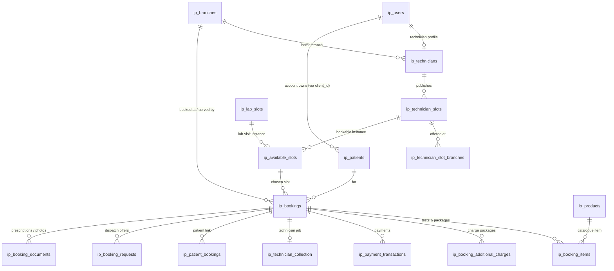

# MicroLab: Data Dictionary

MySQL / MariaDB. Every application table is prefixed `ip_`.

> **How this was built, and its limits.** The base schema (`ip_bookings`, `ip_users`, `ip_patients`…) was created before this repository and **is not in `server/migrations/`**. The columns below come from two sources:
> 1. the `CREATE` / `ALTER` statements in `server/migrations/` (types shown);
> 2. the columns the server code actually reads and writes (types not shown).
>
> Columns used only by the admin panel may be missing. **Action for the team:** export a schema-only dump (`mysqldump --no-data`, no patient data) into `server/db/schema.sql` and keep it updated with each migration. Then this page can be checked against it.

Column notes in *italics* explain business meaning. Ask before guessing what an unexplained column means.

---

## Entity overview

Family members in one visit share `ip_bookings.visit_group_id` (and `ip_patients.visit_group_id`).

---

## Accounts and people

### ip_users
Login accounts for customers and technicians.

| Column | Notes |
|---|---|
| `user_id` | PK |
| `user_mobile_no` | Login mobile number |
| `user_name`, `user_email` | |
| `user_microlab_type` | *Role: `technician` or customer* |
| `access_type`, `user_type`, `role_id`, `user_all_clients` | Legacy role fields |
| `client_id` | *Customer account id; links to `ip_patients.client_id`* |
| `user_otp`, `user_otp_expiry` | Login OTP (never log it) |
| `user_auth_token`, `user_token_expiry`, `session_id` | *Current session. A request's JWT must equal `user_auth_token`, which gives one active device per user.* |
| `is_logged_in`, `user_last_active_at` | |
| `user_notification_token` | FCM token |
| `user_date_created`, `user_date_modified`, `deleted_at` | `deleted_at`: `add_ip_users_deleted_at.sql` |

### ip_patients
The people tests are done for (the account holder and family). Copied from ASMX at each login.

| Column | Notes |
|---|---|
| `patient_id` | PK |
| `patient_id_ref` | *ASMX patient id (upsert key with `client_id`)* |
| `client_id` | Owning customer account |
| `patient_name`, `patient_mobile`, `patient_email`, `patient_gender`, `patient_dob`, `patient_age`, `patient_relation` | `patient_relation`: *self, spouse, child…* |
| `patient_address`, `patient_city`, `patient_photo`, `health_conditions` | |
| `visit_group_id`, `booking_id` | Set when booked as part of a visit |
| `product_*`, `test_code`, `document_required` | Legacy per-patient product fields |
| `created_by`, `updated_by`, `updated_at`, `deleted_at` | |

### ip_clients
Customer accounts as known to the lab system: `client_id`, `client_name`, `client_mobile_no`, `client_reg_source`, `client_date_created`, `client_date_modified`.

### ip_technicians
Technician profile, one row per technician user.

| Column | Notes |
|---|---|
| `technician_id` | PK |
| `user_id` | → `ip_users` |
| `technician_id_ref` | *ASMX technician id, unique* (`add_technician_id_ref.sql`) |
| `technician_code`, `specialization`, `tech_photo`, `tech_city` | |
| `branch_id` | *Home branch → `ip_branches`. Must be a branch that exists: a missing branch makes the technician invisible to dispatch.* |
| `branch_ids` JSON | *ASMX branch **codes** this technician may serve, e.g. `["07","12"]`* (`add_technician_asmx_branches.sql`) |
| `default_branch_id` VARCHAR(10) | *ASMX default branch code* |
| `is_available`, `technician_active`, `max_daily_bookings` | |

### ip_technician_live_location
Latest position and presence per technician (updated about every 5 seconds while on duty).

`technician_id`, `latitude`, `longitude`, `accuracy_meters`, `bearing_degrees`, `speed_kmph`, `battery_level`, `network_type`, `address_label`, `online_status` (*online / offline*), `task_status`, `booking_id`, `socket_id`, `session_id`, `fcm_token`, `last_ping_at` (*heartbeat; used by the offline sweep*), `updated_at`.

### ip_technician_sessions
One duty session per technician per day: `technician_id`, `branch_id`, `session_date`, `session_status`, `availability_status`, `started_at`, `ended_at`, `duty_start_at`, `duty_end_at`, `total_pings`, `total_bookings_assigned`, `total_bookings_completed`.

### ip_technician_location_log / ip_patient_tracking_data / ip_patient_tracking_metadata
GPS history (Sequelize models in `server/models/`). They store latitude/longitude with timestamps, source and accuracy, keyed by technician or patient and booking.

---

## Branches and catalogue

### ip_branches

| Column | Notes |
|---|---|
| `branch_id` | PK |
| `branch_code` VARCHAR(20) | *ASMX branch code, e.g. `07`* (`add_ip_branches_branch_code.sql`) |
| `branch_name`, `branch_address`, `branch_city`, `branch_pincode` | |
| `branch_latitude`, `branch_longitude` | *Used for every distance: branch lookup, dispatch and service charge. A branch with no location is skipped.* |
| `branch_phone`, `branch_mobile`, `branch_email`, `branch_active` | |

### branch_service_areas
*Which pincodes and place names each branch serves* (`001_branch_booking_schema.sql`): `id`, `branch_id`, `pincode` VARCHAR(10), `place_name`, timestamps.

### ip_branch_working_hours
Opening hours per branch (`work_date`, `start_time`, `end_time`), read by `controllers/slotsController.js` when building slots.

### ip_products
The catalogue of tests and packages. **It also holds the service-charge products.**

| Column | Notes |
|---|---|
| `product_id` | PK |
| `product_name`, `product_description`, `product_category`, `product_type` / `type` | |
| `product_price`, `discount_percent` | |
| `test_code` | *ASMX TestId, sent in `blood_test_list`* |
| `document_required`, `pre_instructions` | *Prescription needed? Fasting or other instructions* |
| `product_active` | |
| `from_km`, `to_km` | *Only for **service-charge** products: the round-trip km range this charge covers. Any product with these filled can be picked as a service charge, so ordinary tests must leave them NULL.* |

### ip_chatbot_packages, ip_chatbot_banners
Content for the support chatbot and the home banners.

---

## Slots

### ip_technician_slots
Time windows a technician publishes.

| Column | Notes |
|---|---|
| `tech_slot_id` | PK |
| `technician_id`, `slot_id` | `slot_id` → `ip_slots` time template |
| `slot_date` | |
| `branch_id` | *Legacy single branch; used only when the slot has no rows in `ip_technician_slot_branches`* |
| `max_bookings`, `booked_count`, `is_available` | |
| `duration_minutes` TINYINT | *Appointment length (15/30/40). NULL = old flow* (`003_appointment_scheduling.sql`) |
| `created_by` | |

### ip_technician_slot_branches
*Which branches a slot is offered at* (`add_technician_slot_branches.sql`).

| Column | Notes |
|---|---|
| `tech_slot_id` | PK part → `ip_technician_slots` |
| `branch_id` | PK part → `ip_branches` |
| `created_at` | |

Rule (`services/slotBranches.js`): a slot counts for branch X if it has a row for X here, **or** it has no rows at all and `ip_technician_slots.branch_id = X`.

### ip_slots
Time-of-day templates: `slot_id`, `slot_label`, `slot_start`, `slot_end`, `slot_active`.

### ip_lab_slots
Lab-visit capacity per branch: `lab_slot_id`, `branch_id`, `slot_id`, `max_bookings`, `booked_count`.

### ip_available_slots
The bookable instances the customer picks from.

| Column | Notes |
|---|---|
| `available_slot_id` | PK; `ip_bookings.available_slot_id` points here |
| `technician_slot_id` / `lab_slot_id` | One of these is set |
| `booking_type` | `home_collection` / `lab_visit` |
| `slot_date`, `slot_time`, `is_available` | |
| `created_at`, `updated_at`, `deleted_at` | `004_available_slots_table.sql` |

---

## Bookings

### ip_bookings
One row per patient per order. This is the central table.

**Identity and ownership**

| Column | Notes |
|---|---|
| `booking_id` | PK |
| `booking_ref` | *Customer-facing sequential number* (`change_booking_ref_to_sequential.sql`, offset in `ip_settings.booking_ref_offset`) |
| `patient_id`, `patient_id_ref`, `client_id`, `created_by` | |
| `visit_group_id` | *Shared by every member of a family visit* |
| `source_channel` | *App, admin, chatbot…* |
| `bill_id`, `reference_no` | *ASMX bill id and reference, set by the sync* |
| `client_sync_status` ENUM(`pending`,`synced`,`failed`) | Last ASMX sync result |

**What and when**

| Column | Notes |
|---|---|
| `booking_type` | `home_collection` / `lab_visit` |
| `status` | `scheduled` (future date) → `pending` (today, searching) → `assigned` → `collected` → `handed_to_lab_pending` → `completed`; also `confirmed`, `cancelled` |
| `booking_date`, `available_slot_id`, `slot_id`, `lab_slot_id`, `slot_time`, `start_datetime`, `end_datetime` | |
| `product_id`, `notes`, `doctor_name` | `doctor_name`: `add_doctor_name_to_bookings.sql` |
| `reschedule_count` INT | `005_add_reschedule.sql` |
| `created_at`, `updated_at`, `deleted_at` | |

**Where**

| Column | Notes |
|---|---|
| `collection_address`, `city`, `postal_code` | |
| `collection_latitude`, `collection_longitude` | *Customer location; the start point for every distance* |
| `branch_id`, `branch_code`, `branch_name` | *The branch serving the booking now. Changes to the serving branch on accept.* |
| `original_branch_id` INT, `original_distance_km` DECIMAL(8,2) | *First branch dispatch started at, and customer → branch km. Written once.* |
| `served_branch_id` INT, `served_distance_km` DECIMAL(8,2) | *Branch whose technician accepted, and its km* |
| `distance_difference_km` DECIMAL(8,2) | *served − original (signed)* |
| `extra_distance_km` DECIMAL(8,2) | *max(0, difference)* |

The last four rows come from `add_dispatch_distance_columns.sql`.

**Technician**

| Column | Notes |
|---|---|
| `technician_id`, `technician_name` | Assigned technician |
| `technician_cancelled_by` INT, `technician_cancel_reason` VARCHAR(30), `technician_cancel_note` TEXT, `technician_cancelled_at` | *The last technician who dropped the job* (`006_…`) |

**Money**

| Column | Notes |
|---|---|
| `total_amount`, `discount_amount`, `amount_paid`, `amount_due` | Running totals |
| `payment_status` | e.g. `paid`, `partial`, unpaid |
| `partial_payment_reason` VARCHAR(255) | *Why it was paid in part, or why the OTP was verified with nothing paid* |
| `home_collection_fare` DECIMAL(10,2) | *Service-charge amount* |
| `home_collection_distance_km` DECIMAL(6,2) | *One-way customer → branch km* |
| `km_rate_id` | Legacy `ip_km_rates` pricing (`add_home_collection_fare.sql`) |
| `service_charge_product_id` INT | *The `ip_products` row used as the service charge* |
| `service_charge_km` DECIMAL(8,2) | *Round-trip km used to pick it (one-way × 2)* |
| `service_charge_status` VARCHAR(20) | `NULL` (pre-feature booking, old fare kept) · `pending` · `calculated` (at accept, not yet in the total) · `applied` (in the total, after arrival) · `no_product` (no km range matched) |
| `additional_charge_amount`, `additional_charge_reason` | **Superseded** by `ip_booking_additional_charges`; no longer sent to ASMX |
| `cancelled_at`, `cancelled_by` ENUM(`customer`,`admin`), `cancellation_reason` | `add_cancel_booking.sql` |
| `refund_amount`, `refund_status` ENUM(`none`,`pending`,`initiated`,`processed`) | |

### ip_booking_items
Tests and packages on a booking: `booking_item_id` (PK), `booking_id`, `patient_id`, `product_id`, `product_name_snapshot` (*name at booking time*), `unit_price`, `final_price`, `item_status`, `collected_at`, `created_at`.

### ip_booking_additional_charges
*Charge packages a technician adds on the spot* (`add_booking_additional_charges.sql`).

| Column | Type | Notes |
|---|---|---|
| `charge_id` | INT PK | |
| `booking_id` | INT | |
| `product_id`, `product_name`, `test_code` | | Snapshot of the `ip_products` row |
| `price` | DECIMAL(10,2) | |
| `reason` | VARCHAR(255) | Optional |
| `technician_id` | INT | Who added it |
| `created_at`, `deleted_at` | DATETIME | Soft delete |

### ip_patient_bookings
Booking ↔ patient link, with a copy of the visit state: `booking_id`, `patient_id`, `patient_ref`, `collection_status`, `created_at`.

### ip_booking_documents
Prescriptions and collection-proof photos: `doc_id`, `booking_id`, `booking_item_id`, `patient_id`, `file_name`, `file_path` (*under `server/uploads/`*), `file_description`, `doc_status`, `uploaded_by`, `created_at`.

### ip_prescription_requests
Customers' "book from my prescription" uploads: `request_id`, `client_id`, `patient_id`, `file_paths`, `notes`, `status`, `admin_notes`, `converted_booking_id`, `created_at`.

### ip_feedback
Post-visit ratings: `booking_id`, `patient_id`, `technician_id`, `branch_id`, `overall_rating`, `feedback_comments`, `created_at`.

### ip_test_results, ip_booking_test_status, ip_report_letterhead
Reports:
- `ip_test_results`: `booking_id`, `report_url`, `result_status`
- `ip_booking_test_status`: `bill_id`, `report_status` from the lab webhook
- `ip_report_letterhead`: report header images

---

## Dispatch and the visit

### ip_booking_requests
*Dispatch offers made to technicians.* `booking_id`, `technician_id`, `technician_name`, `request_status`, `total_attempts`, `max_attempts`, `last_sent_at`, `responded_at`, `updated_at`.

### ip_technician_collection
*The technician's job for a booking: the visit state machine.*

| Column | Notes |
|---|---|
| `collection_id` | PK |
| `booking_id`, `booking_ref`, `reference_no`, `patient_id`, `visit_group_id` | |
| `technician_id`, `technician_name`, `slot_id`, `collection_date` | |
| `collection_address`, `collection_latitude`, `collection_longitude` | |
| `collection_status` | `assigned` → `en_route` → `arrived` → `collection_started` → `sample_collected` → `all_collected` → `otp_verified` → `handed_to_lab_pending` → `handed_to_lab` → `sample_received` → `test_in_progress` → `report_ready` / `completed`; or `cancelled` |
| `assigned_at`, `en_route_at`, `arrived_at`, `collection_started_at`, `collected_at`, `otp_verified_at`, `completed_at`, `submitted_at`, `sample_received_at`, `test_in_progress_at`, `report_ready_at` | One timestamp per step |
| `collection_otp`, `collection_otp_expiry`, `otp_attempts` | Handover OTP (never log the code) |
| `received_by_name`, `submitted_to_branch_id` | Lab handover |
| `reminder_sent_at`, `late_alert_1_sent_at`, `late_alert_2_sent_at` | *Claimed once per alert by the reminder scheduler* (`add_technician_alert_columns.sql`) |

---

## Payments

### ip_payment_transactions
One row per payment or refund.

| Column | Notes |
|---|---|
| `transaction_id` PK, `transaction_ref` | |
| `booking_id`, `patient_id`, `collected_by` | `collected_by`: *the technician, for on-the-spot payments* |
| `payment_mode`, `payment_type` | *cash / upi / razorpay / qr…* |
| `gross_amount`, `discount_amount`, `net_amount`, `amount_paid`, `amount_due`, `currency` | |
| `is_partial`, `is_refund` | |
| `payment_status`, `transaction_status` | |
| `gateway_order_id`, `gateway_transaction_id`, `gateway_status` | Razorpay ids |
| `paid_at`, `created_at`, `updated_at` | |

---

## Configuration and keys

### ip_settings
Key / value business switches, cached by `config/settings.js`. Defaults in brackets are what the code uses when the row is missing.

| Key | Meaning |
|---|---|
| `api_auth_required` [false] | Reject tokenless calls on `rolloutAuth` routes |
| `client_sync_enabled` [true], `client_sync_timeout_ms` [10000], `client_sync_retry_enabled`, `client_sync_max_retries` | ASMX sync |
| `visit_completion_sync_enabled` [true] | Send `visit_completed` at handover |
| `booking_ref_offset` | Sequential `booking_ref` base |
| `branch_lookup_days` [7] | How many days ahead a branch must have a bookable slot to count as available |
| `family_booking_enabled` [true], `family_booking_max_members` [4] | |
| `booking_edit_block_if_paid` [true] | |
| `additional_charge_max` [1000] | Legacy single additional charge cap |
| `cancel_allowed_booking_statuses`, `cancel_allowed_collection_statuses`, `cancel_charge_trigger_statuses`, `cancel_service_charge_amount`, `cancel_cutoff_minutes` | Cancellation rules |
| `reschedule_enabled_home` / `_lab`, `reschedule_max_count_home` / `_lab` [2], `reschedule_min_notice_hours_*`, `reschedule_allowed_collection_statuses` | Reschedule rules |
| `technician_reminder_enabled` [true], `technician_reminder_minutes_before` [60], `technician_reminder_skip_if_accepted_within` [10], `technician_late_alert_minutes` ["5,10"] | Reminder scheduler |
| `technician_offline_timeout_sec` [90] | Offline sweep |

### ip_dynamic_keys, ip_key_rotations
Encrypted, versioned secrets managed through the admin Dynamic Key API (`services/dynamicKeyService.js`).
- Columns: `key_name`, `version` (unique pair), `encrypted_value`, `is_active`, `expires_at`, `created_by`, timestamps.
- Values are encrypted with `DYNAMIC_KEY_MASTER_KEY`, which lives only in the server `.env`.
- **Never select or print `encrypted_value`.**

---

## Log tables

Written by `utils/dbLogger.js` alongside the `.log` files. Rows older than `LOG_RETENTION_DAYS` (90) are deleted daily.

| Table | Contents |
|---|---|
| `ip_dispatch_logs` | `booking_id`, `tag`, `details`: each dispatch step |
| `ip_collection_logs` | Visit events per booking / technician |
| `ip_branch_lookup_logs` | Each branch lookup: input (pincode / place / lat-lng / method), `result`, `match_reason`, chosen branch, `is_fallback`, `message` |
| `ip_asmx_logs` | Each ASMX call: `endpoint`, `booking_id`, `request_payload`, `response_payload`, `http_status`, `success`, `error_message` |
| `ip_client_sync_logs` | Sync summary lines |
| `ip_customer_push_logs` | FCM pushes to customers |
| `ip_otp_logs`, `ip_otpinfo_logs`, `ip_login_otp_logs` | OTP events (codes are not stored) |
| `ip_technician_logs` | Technician history and cancel events |
| `ip_report_status_log` | Lab report-status webhooks: `bill_id`, `report_status`, `auth_result`, `http_status`, `ip_address` |

---

## Migrations index

Run by hand, in this order for a new database. All are in `server/migrations/`.

| File | Adds |
|---|---|
| `001_branch_booking_schema.sql` | `branch_service_areas`; branch / location columns on bookings |
| `002_seed_test_slots.sql` | Test slot data (test databases only) |
| `003_appointment_scheduling.sql` | `ip_technician_slots.duration_minutes` |
| `004_available_slots_table.sql` | Timestamps on `ip_available_slots` |
| `005_add_reschedule.sql` | `reschedule_count` + reschedule settings |
| `006_add_technician_cancel_history.sql` | `technician_cancel*` columns |
| `add_cancel_booking.sql`, `add_refund_status_initiated.sql` | Cancellation and refund columns + settings |
| `add_bill_id_and_sync_settings.sql`, `add_client_sync_columns.sql` | ASMX sync columns + settings |
| `add_home_collection_fare.sql`, `add_service_charge_product_id_to_bookings.sql` | Fare columns |
| `add_service_charge_on_accept.sql` | `service_charge_km`, `service_charge_status` |
| `add_dispatch_distance_columns.sql` | original / served / difference / extra distance |
| `add_booking_additional_charge.sql` *(legacy)*, `add_booking_additional_charges.sql` | Charge packages table |
| `add_partial_payment_reason.sql` | `partial_payment_reason` |
| `add_technician_slot_branches.sql` | Per-slot branches |
| `add_technician_asmx_branches.sql`, `add_technician_id_ref.sql`, `add_ip_branches_branch_code.sql` | ASMX ids and branch codes |
| `add_technician_alert_columns.sql` | Reminder / late-alert claims |
| `add_doctor_name_to_bookings.sql`, `add_ip_users_deleted_at.sql`, `add_api_auth_required_setting.sql` | Misc |
| `change_booking_ref_to_sequential.sql` | One-off renumbering of `booking_ref` |
| `create_log_tables.sql`, `create_ip_asmx_logs.sql`, `create_ip_branch_lookup_logs.sql`, `create_ip_report_status_log.sql` | Log tables |
| `create_dynamic_keys_table.sql`, `add_dynamic_keys_version_unique.sql`, `create_test_dynamic_key_table.sql` | Dynamic keys |
| `create_prescription_requests.sql` | Prescription uploads |
| `adminmicro_mobile_setup.sql`, `add_demo_technician.sql`, `seed_demo_technician_data.sql` | Setup and demo data |

> Recommended: keep a `migrations-log.md` (or a `schema_migrations` table) recording which file ran on which database and when. Today that is only known from memory.
